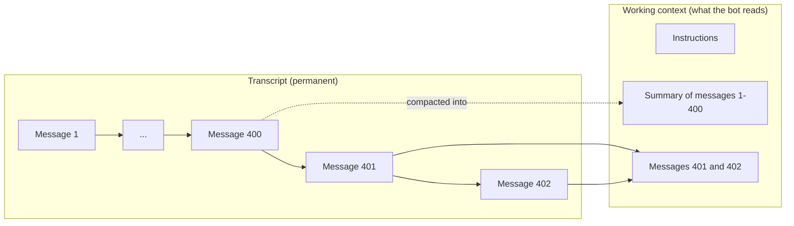

Each bot has one bot chat with you, and it never starts over. There's no "new
chat" button: you keep talking in the same place, whether the last message was
a minute ago or a month ago.

Messages from [Discord](/concepts/discord) join the same bot chat. Only the
answer associated with each Discord request returns to Discord.

## Transcript and Working Context

A chat that lasts for months can't fit in a model's context, so Crumble keeps
two things apart:

| Name                | What it holds                                                                                                             | Size           |
| ------------------- | ------------------------------------------------------------------------------------------------------------------------- | -------------- |
| **Transcript**      | Every message, reply, tool call, and piece of background work.                                                            | Grows forever. |
| **Working context** | What the bot reads when it answers: recent messages, summaries of older ones, its instructions, and anything it recalled. | Kept small.    |

When the working context gets large, the bot **compacts** it. Older messages
are replaced by a summary in the working context, and the transcript stays
exactly as it was.

**Compaction never deletes anything you can see.** It only changes what the
bot reads on its next turn.

## Bringing Back an Earlier Message

Reply to a message to bring it back into focus. The bot reads that message and
the messages around it before it answers.

## Searching the Transcript

Bots can search and read their own transcripts, including messages that were
compacted away long ago. Ask in plain language, such as "What did I say about
the domain renewal in March?"

A bot searches only what it's allowed to see:

| Where you ask | What the bot searches                              |
| ------------- | -------------------------------------------------- |
| Its bot chat  | That chat, and the group chats the bot belongs to. |
| A group chat  | Only that group chat.                              |

In a group chat, a bot can't search its bot chat with you, even if you ask it
to. For how group chats work, see
[Group Chats](/concepts/group-chats).
