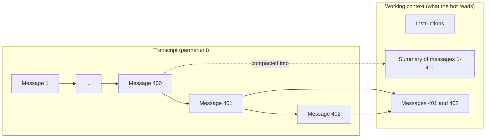

Each bot has one bot chat with you, and it never starts over. There's no "new
chat" button: you keep talking in the same place, whether the last message was
a minute ago or a month ago.

Messages from [Discord](/concepts/discord) join the same bot chat. Only the
answer associated with each Discord request returns to Discord.

## Transcript and Working Context

A chat that lasts for months can't fit in a model's context, so Crumble keeps
two things apart:

| Name                | What it holds                                                                                                             | Size           |
| ------------------- | ------------------------------------------------------------------------------------------------------------------------- | -------------- |
| **Transcript**      | Every message, reply, tool call, and piece of background work.                                                            | Grows forever. |
| **Working context** | What the bot reads when it answers: recent messages, summaries of older ones, its instructions, and anything it recalled. | Kept small.    |

When the working context gets large, the bot **compacts** it. Older messages
are replaced by a summary in the working context, and the transcript stays
exactly as it was.

**Compaction never deletes anything you can see.** It only changes what the
bot reads on its next turn.

## Files

In the web client, attach any file up to 100 MB, with at most eight files per
message. Attaching uploads the file to that chat's library immediately.
Removing it from the composer removes it from the draft, not the library.
Uploading the same content again reuses the entry in that library.

A bot's details list its five newest files; select one to download it. Select
**See all** there, or **Library** in a group chat, to open the full library.
It lists files newest first as a list or a grid. Select a file to download it,
or use its menu to delete it. Select **Upload**, or drop files onto the page,
to add files to the library without sending a message. Each bot and each
group chat has its own library. Files sent on Discord don't reach the bot or
its library.

The bot receives small UTF-8 text files inline, up to 32 KB of text. Crumble
extracts PDF text at upload and uses the same inline limit. Longer text and
other formats arrive as references with a name, type, and size. Every file the
bot receives states its file ID. If PDF extraction fails or finds no text, the
reference says so.

The bot's library tool can list files, search the whole library by name,
description, and text, read a file's text in parts, and search within a file.
Bots keep a short description of what each file is, such as "birth
certificate", so they can find a scan or photo later from how you refer to it.
The library page doesn't show these descriptions. In a group chat it reaches the group library and its own library, not
another member's. Coding and desktop jobs reach their bot's library. A bot
with a workspace can copy a file there to inspect other formats.

PNG, JPEG, GIF, and WebP images up to 5 MB reach the model as images; larger
images arrive as references. A bot whose model reads images sees them as they
are. A bot whose model can't read images refuses a message with an inline image,
unless the account has a [vision model](/getting-started/providers#vision-model).

With a vision model set, the vision model reads each image and describes it,
including any visible text. The bot works from the description, and the
transcript keeps the original image. The bot can also ask the vision model a
question about an image it already received, such as "What's the total on this
receipt?", so the first description needn't hold every detail.

If the vision model can't read an image, the bot gets a note saying so in its
place and answers anyway. The next turn tries the image again.

Deleting a library file stops future downloads and changes its transcript
entry to **File deleted**. A queued message still arrives, with a deleted-file
note. What the bot already read stays in its working context until compaction.
Deleting the bot or group chat also removes its library.

Files attached before the library update aren't migrated: their transcript
entries show **File deleted**. Older native clients need an update before they
can send files again.

## Bringing Back an Earlier Message

Reply to a message to bring it back into focus. The bot reads that message and
the messages around it before it answers.

## Searching the Transcript

Bots can search and read their own transcripts, including messages that were
compacted away long ago. Ask in plain language, such as "What did I say about
the domain renewal in March?"

A bot searches only what it's allowed to see:

| Where you ask | What the bot searches                              |
| ------------- | -------------------------------------------------- |
| Its bot chat  | That chat, and the group chats the bot belongs to. |
| A group chat  | Only that group chat.                              |

In a group chat, a bot can't search its bot chat with you, even if you ask it
to. For how group chats work, see
[Group Chats](/concepts/group-chats).
