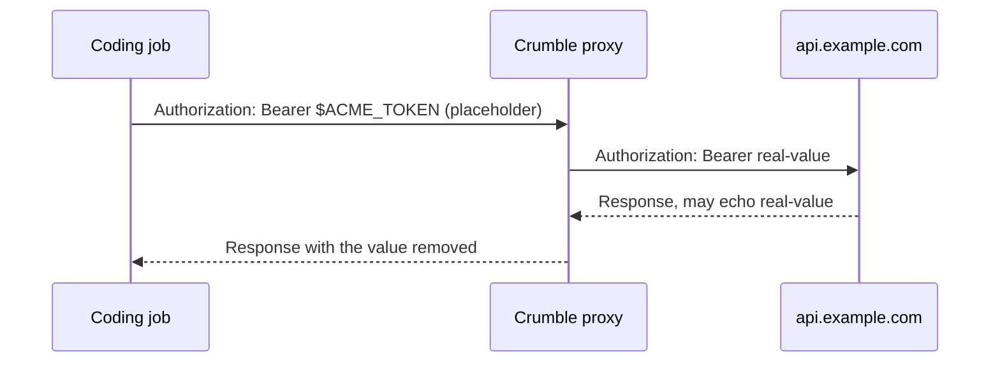

A credential is a secret you give one bot for a list of hosts, such as an API
token for `api.example.com`. The bot's coding jobs can use it, but the real
value never enters the workspace.

## How It Works

The coding job only ever sees a random placeholder in an environment variable,
such as `$ACME_TOKEN`. The server swaps it for the real value on the way out
and takes the value back out of the response on the way in:



A request to any host that isn't on the credential's list keeps the
placeholder, so the job can't send the value somewhere else.

The swap happens only in request headers, such as `Authorization` or
`X-Api-Key`. A placeholder in the URL or the body is sent as it is, because
services log, store, and echo URLs and bodies, and that would let a job read
the value back. **An API that only takes its key as a query parameter can't
use a credential.**

A credential can't sign in through a web page either, because the page's own
scripts read and send the password. For that, give the bot a
[login](/concepts/logins).

## Least Access

**The bot can do anything the credential allows on its hosts.** The
placeholder keeps the value out of the workspace, not the bot away from the
API. Give the bot a token scoped to the work you want from it, such as a
read-only token or one limited to a single repository, rather than your
full-access key.

Every use is logged for 90 days.

## Adding a Credential

Open **Settings** > **Credentials**, select **New credential**, pick the bot,
and add the secret with the hosts it's for.

A bot can also ask you for a credential when it needs one. The request shows
up as a card in the bot chat. Enter the value or decline the request there, or
answer it under **Waiting for you** in **Settings** > **Credentials**. Either
way, the value never appears in the transcript, notices, or logs.

## Values in a Password Manager

Instead of storing the value in Crumble, a credential can read it from
1Password or Bitwarden Secrets Manager.
[Connect the password manager](/concepts/password-managers), then select it
above **Value** in the credential's editor and paste the reference.

Over the API, send `reference` instead of `value` to
`PUT /v1/agents/{id}/credentials/{name}`:

```json
{
  "hosts": ["api.example.com"],
  "reference": {
    "passwordManager": "1password",
    "reference": "op://Private/Acme/credential"
  }
}
```

If the value can't be read, the server doesn't send the request and records
why in the credential's uses. The credential's row shows the newest such
error, and the API returns it as `lastError`.

## GitHub Identities

Bots can push, commit, and open pull requests on GitHub as their own GitHub
App instead of as you, or as you with the App marking their work. Manage Apps
in **Settings** > **Coding**.

An App is private to the GitHub account that owns it, your own or an
organization's, and works only in that account's repositories. To work in
several accounts, create one App per account. A bot uses at most one App per
account, and several bots can share one.

1. Select **New GitHub App**, enter a name, which must be unique on GitHub,
   and an organization, or leave it empty for your own account. GitHub opens
   to create the App.
2. Back in Crumble, select **Install** on the App's row and choose the
   repositories it may use. GitHub sends you back to Crumble, which finds the
   installation. If you install it from another browser tab, open the App and
   select **Check**.
3. Open the App and turn on the bots that should use it.

The App asks for write access to code, pull requests, and issues, and read
access to checks and Actions runs. It can't change workflow files.

A bot with an installed App gets the `GH_TOKEN` credential for `github.com`,
`api.github.com`, and `uploads.github.com`. Its value is an installation
token, minted from the App's private key when a request uses it. The server
picks the App whose account owns the repository in the request's path. A
request without one, such as a GraphQL call, uses the bot's first App, its
default. `git` over HTTPS and the GitHub CLI, `gh`, which the workspace
image includes, sign in with it.

Commits default to the first App's `slug[bot]` user. Coding jobs are told to
set the matching author in repositories of the bot's other accounts, and to
open pull requests there with `gh api` instead of `gh pr`. Commits made this
way aren't signed, so GitHub shows them as unverified.

Removing an App in Crumble doesn't delete it on GitHub: delete it in its
settings there.

Over the API: `GET /v1/github-apps`, `POST /v1/github-apps/manifest` and
`.../complete`, `POST /v1/github-apps/{id}/connect`,
`PUT /v1/github-apps/{id}/bots`, and `DELETE /v1/github-apps/{id}`.

### Acting as You

Bots can also act as your own GitHub user, so their work lands under your
name, marked as theirs:

- GitHub shows their issues, pull requests, and comments with your avatar and
  the App's badge.
- Their commits end with a `Co-authored-by` trailer for the App, so GitHub
  shows its avatar next to yours. A hook adds it in repositories the workspace
  clones, unless a repository sets `core.hooksPath`; coding jobs are told to
  add it elsewhere.

Open the App and select **Sign in as me**. GitHub asks you to authorize the
App, then sends you back. From then on, the App's bots use your token in the
App's account. It reaches only repositories that both you and the App can
access. GitHub limits the token to eight hours; Crumble refreshes it on use
for up to six months, after which you sign in again. **Sign out** revokes it.

An App created before Crumble kept its client secret shows a callback URL
instead. In the App's settings on GitHub, add that URL as a callback URL,
generate a client secret, and paste it into the App's sheet.

Over the API: `POST /v1/github-apps/{id}/sign-in` and
`/v1/github-apps/sign-in/complete`, `DELETE /v1/github-apps/{id}/user`, and
`PUT /v1/github-apps/{id}/client-secret`.

### Machine Accounts

An App works only in its own account's repositories. To let bots work
anywhere else, such as in other people's repositories, forks, and public
issues, give them a machine account: a GitHub user you create for them.
GitHub allows one free machine account per person.

1. Create a GitHub user for your bots. Invite it as a collaborator to the
   private repositories it should reach.
2. Signed in as that user, create a personal access token. A fine-grained
   token is limited to the repositories you pick; a classic token with the
   `repo` scope reaches every repository the user can.
3. In **Settings** > **Coding**, select **New machine account** and paste the
   token. Crumble checks it with GitHub and shows the user's login.
4. Open the account and turn on the bots that should act as it.

A bot acts as at most one machine account, and several bots can share one.
Each gets the `GH_TOKEN` credential. In a repository whose account has one of
the bot's Apps, the App still acts. Every other request, including requests
without an account in their path, such as GraphQL calls, uses the machine
account's token. Commits default to the machine account as their author.

A token expires when GitHub says it does. Before then, open the account and
paste a new token of the same user under **Replace token**. Removing the
account forgets its token; revoke the token on GitHub too.

Over the API: `GET` and `POST /v1/github-accounts`,
`PUT /v1/github-accounts/{id}/token`, `PUT /v1/github-accounts/{id}/bots`,
and `DELETE /v1/github-accounts/{id}`.
