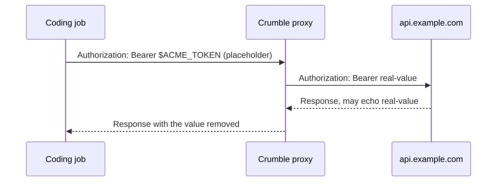

A credential is a secret you give one bot for a list of hosts, such as an API
token for `api.example.com`. The bot's coding jobs can use it, but the real
value never enters the workspace.

## How It Works

The coding job only ever sees a random placeholder in an environment variable,
such as `$ACME_TOKEN`. The server swaps it for the real value on the way out
and takes the value back out of the response on the way in:



A request to any host that isn't on the credential's list keeps the
placeholder, so the job can't send the value somewhere else.

The swap happens only in request headers, such as `Authorization` or
`X-Api-Key`. A placeholder in the URL or the body is sent as it is, because
services log, store, and echo URLs and bodies, and that would let a job read
the value back. **An API that only takes its key as a query parameter can't
use a credential.**

A credential can't sign in through a web page either, because the page's own
scripts read and send the password. For that, give the bot a
[login](/concepts/logins).

## Least Access

**The bot can do anything the credential allows on its hosts.** The
placeholder keeps the value out of the workspace, not the bot away from the
API. Give the bot a token scoped to the work you want from it, such as a
read-only token or one limited to a single repository, rather than your
full-access key.

Every use is logged for 90 days.

## Adding a Credential

Open **Settings** > **Credentials**, select **New credential**, pick the bot,
and add the secret with the hosts it's for.

A bot can also ask you for a credential when it needs one. The request shows
up as a card in the bot chat. Enter the value or decline the request there, or
answer it under **Waiting for you** in **Settings** > **Credentials**. Either
way, the value never appears in the transcript, notices, or logs.

## Values in a Password Manager

Instead of storing the value in Crumble, a credential can read it from
1Password or Bitwarden Secrets Manager.
[Connect the password manager](/concepts/password-managers), then select it
above **Value** in the credential's editor and paste the reference.

Over the API, send `reference` instead of `value` to
`PUT /v1/agents/{id}/credentials/{name}`:

```json
{
  "hosts": ["api.example.com"],
  "reference": {
    "passwordManager": "1password",
    "reference": "op://Private/Acme/credential"
  }
}
```

If the value can't be read, the server doesn't send the request and records
why in the credential's uses. The credential's row shows the newest such
error, and the API returns it as `lastError`.

## A Bot's Own GitHub Identity

A bot with coding jobs can get its own GitHub App, so its commits, pushes,
and pull requests show as the bot instead of you. Each bot gets its own App.

1. Open the bot's settings and turn on **Coding** under
   **Capabilities**.
2. In the **GitHub** row, enter an organization to create the App there, or
   leave it empty for your own account, and select **Create App**. GitHub
   asks you to confirm the App's name, which must be unique on GitHub.
3. Select **Install** and choose the repositories the bot may use. GitHub
   sends you back to Crumble, which finds the installation. If you install
   the App from another browser, select **Check** instead.

The App is private, so it can be installed only on the account or
organization that owns it. It asks for write access to code, pull requests,
and issues, and read access to checks and Actions runs. It can't change
workflow files.

Once the App is installed, the bot gets the `GH_TOKEN` credential for
`github.com` and `api.github.com`. Its value is an installation token that
the server mints from the App's private key when a request uses it, and
replaces before its hour runs out. Coding jobs commit as the App's
`slug[bot]` user. `git` over HTTPS to `github.com` and the GitHub CLI,
`gh`, which the workspace image includes, sign in with the token. Commits made this way aren't signed, so GitHub shows them as
unverified.

**Remove** forgets the App and deletes `GH_TOKEN`. The App stays on GitHub:
delete it in its settings there.

Over the API: `GET` and `DELETE /v1/agents/{id}/github-app`, and `POST`
to `.../manifest`, `.../complete`, and `.../connect`.
