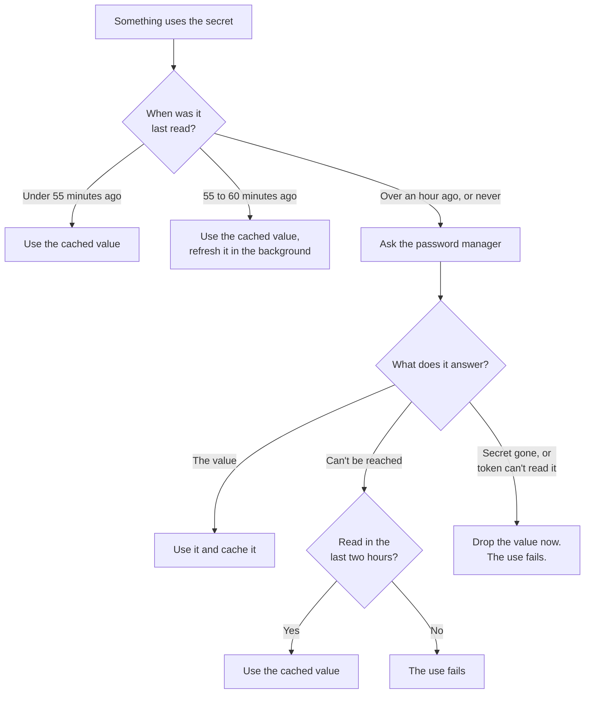

A password manager keeps your secrets where they already are, and Crumble
reads them when it needs them. Crumble supports 1Password and Bitwarden
Secrets Manager.

Four kinds of secrets can come from one:

- A bot's [credential](/concepts/credentials).
- A field of a bot's [login](/concepts/logins).
- A [model provider's](/getting-started/providers) API key.
- An [MCP server's](/concepts/schedules-and-integrations#mcp-integrations)
  bearer token.

Crumble only reads. It never writes or changes a secret in your password
manager.

## Connecting a Password Manager

First, create a token that can read the secrets Crumble needs:

| Password manager          | Token                                                                  |
| ------------------------- | ---------------------------------------------------------------------- |
| 1Password                 | A service account token with read access to the vaults that hold them. |
| Bitwarden Secrets Manager | A machine account access token with read access to their projects.     |

Then, in the web app, open **Settings** > **Password managers**, select
**Connect** next to the password manager, paste the token, and select
**Connect**.

Crumble signs in once to check the token, then stores it encrypted with your
account's key. To change it, open the row's **More** menu and select
**Replace token**. Values read with the old token are dropped.

Over the API, send `{"token": "..."}` to `PUT /v1/password-managers/{id}`,
where `{id}` is `1password` or `bitwarden`.

## Pointing a Secret at It

In the editor for a credential, a login, a provider's API key, or an MCP
server's token, select the password manager above the value field instead of
**Crumble**, then paste a reference:

| Password manager | Reference                                                   |
| ---------------- | ----------------------------------------------------------- |
| 1Password        | A secret reference, such as `op://Private/Acme/credential`. |
| Bitwarden        | The secret's ID.                                            |

Crumble reads the reference once when you save and rejects the save if it
can't read it. Nothing changes until it can.

## When Crumble Reads a Secret

Crumble reads a secret only when something uses it, such as a request with a
credential's placeholder or a model call. It keeps the value in memory, never
on disk, and decides on each use whether to ask the password manager again:

Changing or removing a secret's reference drops its value too.

## When a Secret Can't Be Read

What fails depends on the kind of secret:

| Secret               | What happens                                                                                   | Where you see it                                       |
| -------------------- | ---------------------------------------------------------------------------------------------- | ------------------------------------------------------ |
| **Credential**       | The server doesn't send the request and answers it with an error that names the credential.    | The credential's row in **Settings** > **Credentials** |
| **Login**            | Nothing is typed, and the desktop job is told the value couldn't be read.                      | The login's row in **Settings** > **Logins**           |
| **Provider API key** | The model call fails with an error that names the provider and the password manager's message. | The failed model call's error                          |
| **MCP server token** | The bot answers without that server's tools.                                                   | The server's entry in **Integrations**                 |

## Disconnecting

Open the row's **More** menu and select **Disconnect**.

If **Disconnect** is unavailable, some secrets still read from the password
manager, and the row says how many, such as **(used by 3)**. Switch those
secrets to **Crumble** or another reference first.
