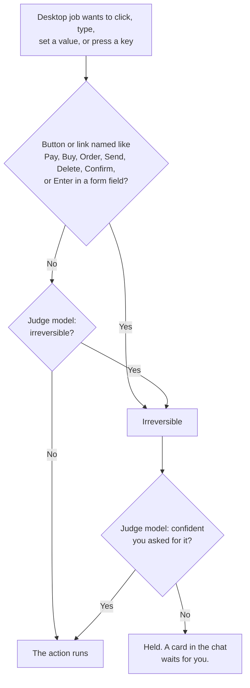

Each bot has a **workspace**: a Linux machine with a persistent `/workspace`
disk that only that bot and its jobs can reach. The machine starts when the bot
or a job needs it and stops when it's idle, and the files on the disk stay.

| Comes with                                                     | Doesn't come with                            |
| -------------------------------------------------------------- | -------------------------------------------- |
| Bun, Node with npm, Python with uv, git, `gh`, and build tools | Your project's own tools, such as Playwright |

The server has to support workspaces before bots can use them. See
[Set Up Workspaces](/self-hosting/workspaces).

## Working in the Workspace

A bot with **Coding** works in its workspace itself, the way a coding agent
does: it reads and edits files and runs shell commands right in the chat, and
in group chats too. You see each step as tool activity in the transcript.
Chatting alone never starts the machine; the first command does.

## Jobs

For work that runs beside the chat, such as several tasks at once or one that
would block the chat for a long time, the bot hands the work to a job instead.
The job runs in the background, and its answer comes back to the chat.

There are two kinds of job:

| Job             | What it does                                                     | Needs           |
| --------------- | ---------------------------------------------------------------- | --------------- |
| **Coding job**  | Edits files and runs shell commands in the background.           | **Coding**      |
| **Desktop job** | Uses a graphical desktop with Chromium, a mouse, and a keyboard. | **Bot desktop** |

You don't pick the kind. Ask in plain language, such as "Clone my site's
repository and fix the broken link on the about page," and the bot decides.

A job starts knowing what the bot knows: your instructions for the bot, its
memories, its skills, and the latest messages of the chat it was started from. So the bot tells it only the
task and what's specific to it. A job can load the bot's skills, but it can't
change skills or memories, start other jobs, ask other bots, or schedule
automations.

On web pages, a desktop job reads the page and acts on its elements directly,
which is faster than going through the screen. Other apps, and the browser's
own menus, it operates through their accessibility tree.

The bot and both kinds of job share the same machine. The bot or a coding job
can start a web server, run browser tests against it, and then hand the address
to a desktop job that checks the page by hand.

A coding job reuses a repository that an earlier job cloned: it fetches,
branches from the default branch, and reinstalls dependencies only when the
lockfile changed. What a job learns about a repository, such as its check
commands, goes into the bot's [learned skills](/concepts/memory-and-skills).

## Workspace Notes

Every job starts with the bot's **workspace notes** in its prompt: facts the
bot and its jobs learned about this machine, so nobody rediscovers them. The
bot and its coding jobs keep the notes current, such as a tool installed outside
`/workspace` and how to install it again, a command that needs a flag or
environment variable, where a clone lives and how to run its checks, or a
server left running and the command that starts it. Desktop jobs only read
them.

The notes are a plain file, `/workspace/.crumble/notes.md`, that you can ask
the bot to read or edit. A job sees the first 4 KB. The bot and its jobs are
told never to write secrets in it. The bot's chat shows the notes only while
the workspace is running, so chatting never starts the machine; otherwise the
bot is told where they are.

## Questions From Coding Jobs

A coding job works without asking, but when an answer changes what it builds
it asks you. The question appears in the chat and on the job's panel, often
with a few answers to pick from, sometimes several at once; you can always
write your own instead. Answer
in either place and the job continues. Questions survive a server restart.

When another bot delegated the job's task, that bot gets the question first
and may answer it. The question still shows in the chat and on the panel until
someone answers; once the job has an answer, a second one is refused. See
[Messaging Other Bots](/concepts/schedules-and-integrations#messaging-other-bots).

While the job waits, its workspace keeps running for the server's question
grace period, 15 minutes unless an admin changed it, so servers the job
started stay up. After that the workspace stops as usual, and your answer
starts it again with its files.

## What's on the Bot Desktop

The bot desktop is an XFCE desktop. A dock at the bottom opens **Files** (the
Thunar file manager), **Terminal**, and **Chromium**. New windows open
maximized; switch between them with Alt+Tab.

It also has a text editor (Mousepad) and an image viewer (Ristretto), so files
open from Files with an app. Files and the terminal start in `/workspace`, the
same files the bot and its coding jobs work on, so a desktop job can open, move,
rename, or drag files. A desktop job can start any installed app, including one
the bot installed in the workspace, not only the browser. Chromium saves
downloads to `/workspace/Downloads`. Thunar deletes files permanently; there's
no trash.

## Watching the Bot Desktop

Open a bot's desktop from the web app to watch its screen live. You can't type
or click while the bot is in control.

You can also ask the bot for a screenshot, such as "Show me your desktop." The
bot shows the whole screen as an image in the chat. It only captures a desktop
that's already running and never starts one. If a password was typed into the
browser that's open now, the bot refuses until the browser restarts, so the
screenshot can't show it. Screenshots appear in the web app only; Discord gets
the bot's text without the image.

## Taking Control

Sometimes a bot needs you, such as to sign in to a site or enter a two-factor
code.

1. Click **Take control**. The bot's desktop work pauses.
2. Do what's needed on the desktop.
3. Click **Hand back**. The bot continues.

The bot stays paused until you hand back control, even if you close the page
or the server restarts.

## Held Actions

Before a desktop job clicks, types, sets a value, or presses a key, an
**intent check** asks two questions: is the action irreversible, and did you
ask for it? Reading the screen and opening pages aren't checked.

The [judge model](#choosing-the-judge-model) answers from your own messages,
the job's task, and the action with its target, such as the button's role and
name and the page's host. **It never reads the page's text, so a page can't
talk it into an action.** The named buttons count as irreversible in several
languages, whatever the judge says. Enter in a terminal is the exception: it
runs a command in the bot's own workspace, so the judge decides from the
command itself, and a command that deletes, kills, pushes, or publishes is
held. When the command can't be read, or no judge answers, Enter in a
terminal is held like any other commit point.

A held action shows up as a card in the bot's chat with the action in plain
words, the page, and the messages it was checked against.

- Select **Approve** to run the action. The job continues where it stopped.
- Select **Decline**, add a reason if you like, and select **Decline** again.
  The job is told you declined, with your reason, and reports back.

A held job waits without a time limit, and the bot's other desktop jobs wait
behind it. If the server restarts while an action is held, the card shows
**Expired** and the action doesn't run.

### What Counts as Your Request

The job knows your words, not only the bot's summary of them. When the bot
starts a job or sends it a message, it names the messages of yours the task
comes from, and your latest message is always included.

| Job started by       | What counts as your request                                       |
| -------------------- | ----------------------------------------------------------------- |
| You, through the bot | Your messages that the bot names, plus your latest one.           |
| A prompt automation  | The automation's instructions.                                    |
| A script automation  | Nothing. Whatever the script reads could have written its output. |

### Choosing the Judge Model

Choose the judge model in **Settings** > **Judge model**. One judge model
checks every desktop job on the account.

The default is GPT-6 Luna through OpenAI Decisions. It needs an OpenAI API
key: signing in with ChatGPT isn't enough. Other classifier models your
provider keys reach are listed too, such as Jev from TypeSafe.

How sure the judge has to be that you asked depends on the model:

| Judge                                                        | Holds the action when                                                                    |
| ------------------------------------------------------------ | ---------------------------------------------------------------------------------------- |
| Jev                                                          | It's less than 50% sure you asked.                                                       |
| A classifier that hasn't been evaluated, GPT-6 Luna included | It's less than 90% sure you asked.                                                       |
| A small chat model, such as Claude Haiku 5.5                 | It's a named button and the model doesn't answer that you asked. It gives no confidence. |
| No model at all                                              | It's a named button, or Enter in a form field.                                           |

Jev's 50% comes from Crumble's intent eval, where Jev rated every action the
owner asked for at 55% or more, and every one they didn't at 42% or less.
A small chat model is only used when no key reaches a classifier model.

## Giving the Bot a Secret

To let the bot and its coding jobs use an API key or token without it ever
entering the workspace, give the bot a [credential](/concepts/credentials). To let a desktop
job sign in to a website, give it a [login](/concepts/logins).
