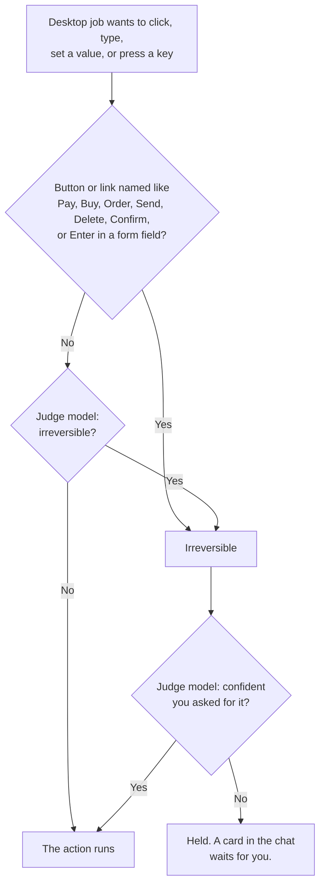

Each bot has a **workspace**: a Linux machine with a persistent `/workspace`
disk that only that bot's jobs can reach. The machine starts when a job needs
it and stops when it's idle, and the files on the disk stay.

| Comes with                                | Doesn't come with |
| ----------------------------------------- | ----------------- |
| Bun, Python with uv, git, and build tools | Node              |

The server has to support workspaces before bots can use them. See
[Set Up Workspaces](/self-hosting/workspaces).

## Jobs

A bot doesn't do long work in the chat itself. It hands the work to a job that
runs in the background, and the job's answer comes back to the chat.

There are two kinds of job:

| Job             | What it does                                                     | Needs           |
| --------------- | ---------------------------------------------------------------- | --------------- |
| **Coding job**  | Edits files and runs shell commands.                             | **Coding**      |
| **Desktop job** | Uses a graphical desktop with Chromium, a mouse, and a keyboard. | **Bot desktop** |

You don't pick the kind. Ask in plain language, such as "Clone my site's
repository and fix the broken link on the about page," and the bot decides.

On web pages, a desktop job reads the page and acts on its elements directly,
which is faster than going through the screen. Other apps, and the browser's
own menus, it operates through their accessibility tree.

Both kinds share the same machine. A coding job can start a web server, run
browser tests against it, and then hand the address to a desktop job that
checks the page by hand.

## Watching the Bot Desktop

Open a bot's desktop from the web app to watch its screen live. You can't type
or click while the bot is in control.

## Taking Control

Sometimes a bot needs you, such as to sign in to a site or enter a two-factor
code.

1. Click **Take control**. The bot's desktop work pauses.
2. Do what's needed on the desktop.
3. Click **Hand back**. The bot continues.

The bot stays paused until you hand back control, even if you close the page
or the server restarts.

## Held Actions

Before a desktop job clicks, types, sets a value, or presses a key, an
**intent check** asks two questions: is the action irreversible, and did you
ask for it? Reading the screen and opening pages aren't checked.

The [judge model](#choosing-the-judge-model) answers from your own messages,
the job's task, and the action with its target, such as the button's role and
name and the page's host. **It never reads the page's text, so a page can't
talk it into an action.** The named buttons count as irreversible in several
languages, whatever the judge says.

A held action shows up as a card in the bot's chat with the action in plain
words, the page, and the messages it was checked against.

- Select **Approve** to run the action. The job continues where it stopped.
- Select **Decline**, add a reason if you like, and select **Decline** again.
  The job is told you declined, with your reason, and reports back.

A held job waits without a time limit, and the bot's other desktop jobs wait
behind it. If the server restarts while an action is held, the card shows
**Expired** and the action doesn't run.

### What Counts as Your Request

The job knows your words, not only the bot's summary of them. When the bot
starts a job or sends it a message, it names the messages of yours the task
comes from, and your latest message is always included.

| Job started by       | What counts as your request                                       |
| -------------------- | ----------------------------------------------------------------- |
| You, through the bot | Your messages that the bot names, plus your latest one.           |
| A prompt automation  | The automation's instructions.                                    |
| A script automation  | Nothing. Whatever the script reads could have written its output. |

### Choosing the Judge Model

Choose the judge model in **Settings** > **Judge model**. One judge model
checks every desktop job on the account.

The default is GPT-6 Luna through OpenAI Decisions. It needs an OpenAI API
key: signing in with ChatGPT isn't enough. Other classifier models your
provider keys reach are listed too, such as Jev from TypeSafe.

How sure the judge has to be that you asked depends on the model:

| Judge                                                        | Holds the action when                                                                    |
| ------------------------------------------------------------ | ---------------------------------------------------------------------------------------- |
| Jev                                                          | It's less than 50% sure you asked.                                                       |
| A classifier that hasn't been evaluated, GPT-6 Luna included | It's less than 90% sure you asked.                                                       |
| A small chat model, such as Claude Haiku 5.5                 | It's a named button and the model doesn't answer that you asked. It gives no confidence. |
| No model at all                                              | It's a named button, or Enter in a form field.                                           |

Jev's 50% comes from Crumble's intent eval, where Jev rated every action the
owner asked for at 55% or more, and every one they didn't at 42% or less.
A small chat model is only used when no key reaches a classifier model.

## Giving the Bot a Secret

To let a coding job use an API key or token without it ever entering the
workspace, give the bot a [credential](/concepts/credentials). To let a desktop
job sign in to a website, give it a [login](/concepts/logins).
