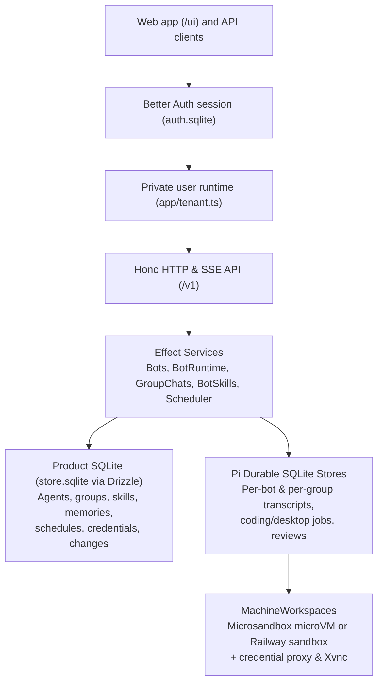

The server (`apps/server`) is a Bun process that serves the `/v1` API and the web app (`apps/web`). Each account runs in its own private runtime with its own storage.

## Boundaries

Server code lives in feature folders under `apps/server/src/`, such as `bots/`, `group-chats/`, `jobs/`, `workspaces/`, and `credentials/`.

- **Accounts (`app/auth.ts`, `app/server.ts`, `app/tenant.ts`):** Better Auth stores accounts and sessions in `auth.sqlite`. Requests authenticate before routing to a private user runtime under `users/USER_ID`. Each account owns its databases, `.secret.key`, bot runtimes, provider logins, and workspace namespace. Startup recovers every account runtime so schedules run without an active session.
- **Effect services (`app/tenant.ts`):** Each account is one Effect `Layer` graph: Drizzle repositories over `ProductDatabase`, then feature services (`Bots`, `BotRuntime`, `GroupChats`, `BotSkills`, `Scheduler`, `BotWorkspaces`, `Plugins`). Features register their bot tools in `BotExtensions`. Tagged errors (`shared/errors.ts`) map to HTTP status codes at the Hono boundary.
- **Product store vs. Pi Durable:** Product SQLite (`store.sqlite`) holds agent profiles, group definitions, memories, skill packages, `learned_changes`, schedules, MCP servers, and encrypted credentials. Each bot owns a separate Pi Durable SQLite store (`agents/<bot id>.sqlite`) for conversation entries, working context, tool calls, compaction, coding/desktop job conversations, and post-turn reviews. Each group chat owns `groups/<group id>.sqlite` for its shared transcript.
- **Plugins and Claude Code (`plugins.ts`, `providers/`):** Compiled-in plugins contribute providers (Melious, Claude Code) and job kinds (coding, desktop). The Claude Code provider runs each model call through a fresh `claude -p` process with an inert MCP tool list, a loopback admission relay, and per-account `users/USER_ID/claude` config directories.
- **Workspaces and credential proxy (`workspaces/`, `credentials/`, `bot-desktop/`):** `MachineWorkspaces` manages lazy boot, holds, idle stop, and `pi-env` streams across Microsandbox microVMs (`MicrosandboxWorkspaces`) and Railway sandboxes (`RailwayWorkspaces`). A per-workspace TLS credential proxy swaps host-bound credential placeholders using a per-bot ECDSA P-256 certificate authority and scrubs secrets from responses. Desktop viewers bridge noVNC to guest Xvnc over an exec stream with an RFB input filter gated by the control lease.
- **Web app (`apps/web/`):** A React app grouped by feature under `apps/web/features/`, using TanStack Router, TanStack Query, Tailwind CSS, and shadcn/ui. Bun bundles it on demand.

## Decisions

Architecture decision records are in [`bot/docs/adr`](https://github.com/crumble-project/bot/tree/main/docs/adr).
