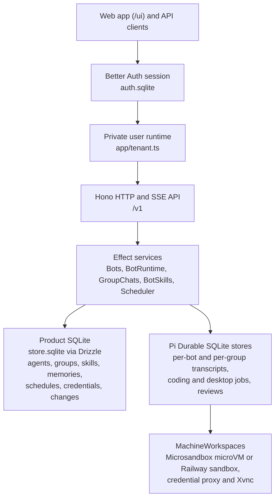

The server (`apps/server`) is one Bun process that serves the `/v1` API and the
web app (`apps/web`). Inside it, each account runs in its own private runtime
with its own storage, so most of the code never has to think about other
accounts.



## On Disk

Every account gets its own directory under `CRUMBLE_DATA_DIR`:

```text
CRUMBLE_DATA_DIR/
├── auth.sqlite              accounts and sessions, shared by all accounts
├── .auth-secret
└── users/
    └── USER_ID/
        ├── .secret.key      or .secret.key.wrapped with a master key
        ├── store.sqlite     product store
        ├── push.sqlite      push store
        ├── agents/
        │   └── BOT_ID.sqlite    one Pi Durable store per bot
        ├── groups/
        │   └── GROUP_ID.sqlite  one per group chat
        └── claude/          Claude Code config for this account
```

## Boundaries

Server code lives in feature folders under `apps/server/src/`, such as
`bots/`, `group-chats/`, `jobs/`, `workspaces/`, and `credentials/`.

### Accounts

`app/auth.ts`, `app/server.ts`, and `app/tenant.ts`. Better Auth stores
accounts and sessions in `auth.sqlite`. Requests authenticate before they're
routed to a private user runtime under `users/USER_ID`. Each account owns its
databases, `.secret.key`, bot runtimes, provider logins, and workspace
namespace. Startup recovers every account runtime, so schedules run without
anyone signed in.

### Effect Services

`app/tenant.ts`. Each account is one Effect `Layer` graph: Drizzle repositories
over `ProductDatabase`, then feature services (`Bots`, `BotRuntime`,
`GroupChats`, `BotSkills`, `Scheduler`, `BotWorkspaces`, `Plugins`). Features
register their bot tools in `BotExtensions`. Tagged errors (`shared/errors.ts`)
map to HTTP status codes at the Hono boundary.

### Product Store and Pi Durable

The two stores split along one line: the product store holds what you
configure, and Pi Durable holds what happens.

| Store                 | File                       | Holds                                                                                                                              |
| --------------------- | -------------------------- | ---------------------------------------------------------------------------------------------------------------------------------- |
| Product SQLite        | `store.sqlite`             | Agent profiles, group definitions, memories, skill packages, `learned_changes`, schedules, MCP servers, and encrypted credentials. |
| Pi Durable, per bot   | `agents/<bot id>.sqlite`   | Conversation entries, working context, tool calls, compaction, coding and desktop job conversations, and post-turn reviews.        |
| Pi Durable, per group | `groups/<group id>.sqlite` | The group chat's shared transcript.                                                                                                |

### Plugins and Claude Code

`plugins.ts` and `providers/`. Compiled-in plugins contribute providers
(Melious, Claude Code), job kinds (coding, desktop), and
[message gateway adapters](/contributing/message-gateway-adapters). The Claude Code
provider runs each model call through a fresh `claude -p` process with an
inert MCP tool list, a loopback admission relay, and per-account
`users/USER_ID/claude` config directories.

### Workspaces and the Credential Proxy

`workspaces/`, `credentials/`, and `bot-desktop/`. `MachineWorkspaces` manages
lazy boot, holds, idle stop, and `pi-env` streams across Microsandbox microVMs
(`MicrosandboxWorkspaces`) and Railway sandboxes (`RailwayWorkspaces`).

A per-workspace TLS credential proxy swaps host-bound credential placeholders,
using a per-bot ECDSA P-256 certificate authority, and scrubs secrets from
responses. Desktop viewers bridge noVNC to the guest's Xvnc over an exec
stream, with an RFB input filter gated by the control lease.

### Web App

`apps/web/`. A React app grouped by feature under `apps/web/features/`, using
TanStack Router, TanStack Query, Tailwind CSS, and shadcn/ui. Bun bundles it
on demand.

## Decisions

Architecture decision records are in
[`bot/docs/adr`](https://github.com/crumble-project/bot/tree/main/docs/adr).
