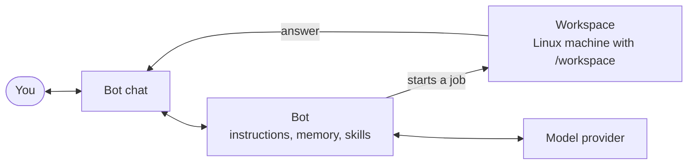

Crumble runs bots on your own server. You give each bot a name, a model, and
instructions once, and then you talk to it in one chat that never resets. When
a task needs real tools, the bot hands it to a job in its own Linux workspace
and reports back in the chat.

Everything in that picture lives on your server. Bots, chats, memories, and
provider sign-ins belong to your account, and no other account on the server
can see them.

## Getting Started

Three pages take you from nothing to a bot that answers:

1. [Install the server](/getting-started/server) with Docker or Bun.
2. [Connect a model provider](/getting-started/providers) with an API key or
   an account you already have.
3. [Create your first bot](/getting-started/first-bot) and send it a message.

## How It Works

| Page                                        | What it explains                                        |
| ------------------------------------------- | ------------------------------------------------------- |
| [Bots](/concepts)                           | What a bot is, and the capabilities you can turn on.    |
| [Chats and History](/concepts/chats)        | How one chat lasts for months without losing a message. |
| [Workspaces and Jobs](/concepts/workspaces) | How bots write code, use a desktop, and wait for you.   |
| [Web App](/clients/web)                     | Where everything is in the interface.                   |

## Running Your Own Server

[Configuration](/self-hosting/configuration) covers what to set before anyone
else can reach the server. [Set Up Workspaces](/self-hosting/workspaces) and
[Back Up and Migrate](/self-hosting/backups) cover the rest. If you'd rather
script Crumble than click through it, start with the
[API reference](/reference/api). To work on Crumble itself, read
[Contributing](/contributing).
