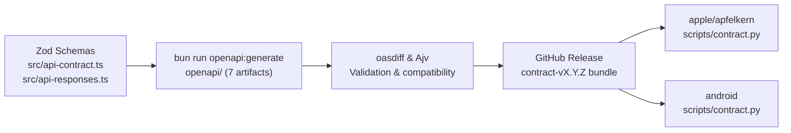

# API contract maintenance

`bot` owns and publishes the HTTP and server-sent event (SSE) contract from its Zod route and response schemas. The contract version (`info.version` in `src/api-contract.ts`) is independent of the server version.



## Exported artifacts

```bash
bun run openapi:generate
bun run openapi:check
bun run contract:validate
```

| Artifact | Source |
| --- | --- |
| `openapi/openapi.json` | Shared route registry (OpenAPI 3.1) |
| `openapi/chat-snapshot.schema.json` | `chatSnapshotResponse` |
| `openapi/group-chat-snapshot.schema.json` | `groupChatSnapshotResponse` |
| `openapi/activity-event.schema.json` | `activityEvent` (`reply` and `chat_preview` union) |
| `openapi/learned-event.schema.json` | `learnedEvent` |
| `openapi/desktop-control.schema.json` | `desktopControlResponse` |
| `openapi/heartbeat.schema.json` | `heartbeatEvent` |

## Change workflow

1. Update the Zod schema and route handler together, using stable operation IDs.
2. Bump `info.version` in `src/api-contract.ts` (major for breaking HTTP/SSE changes or removed event schemas; minor/patch for compatible additions).
3. Add a `## Contract X.Y.Z` section to `CHANGELOG.md`.
4. Run `bun run openapi:generate`, `bun run check`, `bun run contract:validate`, and `bun run contract:compatibility`.
5. Commit the source changes and all seven generated `openapi/` artifacts together.

## Bundles and releases

Export a local provenance bundle (requires a clean working tree):

```bash
bun run contract:bundle [DIRECTORY]
```

Every `contract-vX.Y.Z` release and local bundle contains the seven `openapi/` artifacts plus `CHANGELOG.md` (the current contract version's section), `source-commit.txt`, and `SHA256SUMS`. Pushing a new contract version to `main` publishes an immutable `contract-vX.Y.Z` GitHub release via `.github/workflows/contract.yml` after `oasdiff` compatibility checks pass.

## Server-sent events

All `/v1` streams require bearer authentication and send `event: heartbeat` (`data: {}`) every 15 seconds. Clients must ignore heartbeats and unknown event names and recover state via the corresponding snapshot endpoint on reconnect.

| Endpoint | Event | JSON Schema asset |
| --- | --- | --- |
| `/v1/agents/{id}/events` | `snapshot` | `chat-snapshot.schema.json` |
| `/v1/agents/{id}/events` | `heartbeat` | `heartbeat.schema.json` |
| `/v1/group-chats/{id}/events` | `snapshot` | `group-chat-snapshot.schema.json` |
| `/v1/group-chats/{id}/events` | `heartbeat` | `heartbeat.schema.json` |
| `/v1/agents/{id}/desktop/events` | `control` | `desktop-control.schema.json` |
| `/v1/agents/{id}/desktop/events` | `heartbeat` | `heartbeat.schema.json` |
| `/v1/events` | `activity` | `activity-event.schema.json` |
| `/v1/events` | `learned` | `learned-event.schema.json` |
| `/v1/events` | `heartbeat` | `heartbeat.schema.json` |
