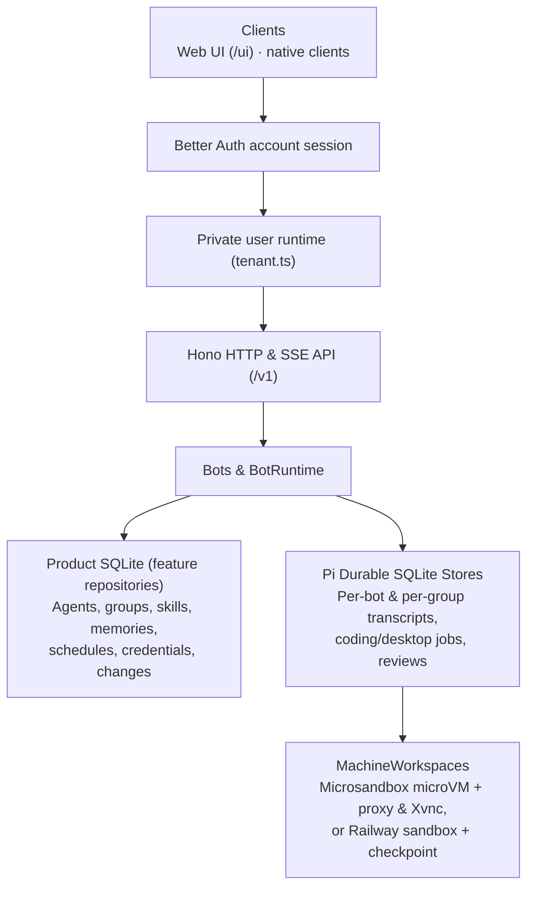

# Crumble server architecture

Crumble is a multi-user, self-hosted agent server with an authenticated `/v1` HTTP and SSE API, a bundled web UI (`/ui`), and native macOS, iOS, and Android clients.

## Core boundaries

Source files named below live in feature folders under `apps/server/src/`, such as `app/tenant.ts`, `bots/bots.ts`, and `bots/runtime.ts`.

- **Accounts (`auth.ts`, `server.ts`, `tenant.ts`):** Better Auth stores accounts and sessions in `auth.sqlite`. The host authenticates every API and viewer request before routing to a private user runtime under `users/USER_ID`. Each runtime owns its databases, files, encryption key, services, event listeners, provider logins, and workspace namespace. Startup recovers every existing account runtime so background schedules continue without an active browser. Shared memories and skills remain inside the account. Host provider environment credentials are ignored.

- **Product store (repositories) vs. Pi Durable (`runtime.ts`):** Product SQLite (`store.sqlite`), read and written through each feature's Drizzle repository, stores agent profiles, canonical chat references, group chats, memories, skill packages, learned-change logs, schedules, MCP servers, and encrypted credentials. Each bot owns a separate Pi Durable SQLite store that manages conversation entries, model calls, tool execution, compaction, and retries.
- **Effect services (`app/tenant.ts`):** Each account is one Effect `Layer` graph: repositories over `ProductDatabase`, then feature services such as `Bots`, `BotRuntime`, `GroupChats`, `BotSkills`, `Scheduler`, and `Push`, each with its own scope. Features offer their bot tools by registering them in `BotExtensions` from a layer of their own. Closing the account releases the graph in reverse. Domain failures are tagged errors (`shared/errors.ts`) that the API maps to HTTP statuses in one place; HTTP handlers reach services through access adapters (`botsAccess`, `groupChatsAccess`, and similar), which keep a Promise API at the Hono boundary.
- **Provider credentials (`provider-auth.ts`):** Encrypted at rest using `.secret.key`. Pi AI owns interactive sign-in, token refresh, and request authentication; `ProviderCredentials` serializes logins, refreshes, key updates, and sign-outs per provider within the account.
- **MCP integrations:** Bots load tools only from enabled, permitted MCP servers. Unreachable or unauthenticated MCP servers are skipped for the turn with their error surfaced in status. OAuth supports dynamic client registration, Client ID Metadata Documents (`CRUMBLE_PUBLIC_URL`), and owner-registered OAuth client credentials.
- **Bundled web UI (`apps/web/`):** React, TanStack Router, TanStack Query, Tailwind CSS, and shadcn/ui served at `/ui` and bundled on demand by Bun.

## Plugins and the Claude Code provider

- **Plugins (`plugins.ts`, `builtin-plugins.ts`, [ADR 0004](adr/0004-plugin-interfaces.md)):** Compiled-in modules contribute Pi AI providers and job kinds. Melious, Claude Code, coding jobs, and desktop jobs are plugins; the tenant runtime enables Claude Code with account-specific paths. The server builds the model catalog, job extensions, job environments, and job-answer notifications from their contributions.
- **Claude Code (`claude-code/`):** A Pi AI provider whose `ProviderStreams` run each model request through a fresh `claude -p` process (`adapter.ts`), ported from Hermes' Claude Subscription DirectSDK. Claude Code gets no built-in tools, only an inert MCP inventory of the turn's tools (`inert-mcp.ts`), and the working context replayed as stream-json frames, each acknowledged before the next. Each tenant supplies `users/USER_ID/claude` as `CLAUDE_CONFIG_DIR` and `users/USER_ID/claude-work` as the working directory. The server can share the executable selected by `CRUMBLE_CLAUDE_COMMAND`, but it never shares the configuration directory or login. A loopback admission relay (`relay.ts`) forwards the CLI's first Messages request with its own authorization, refuses later attempts, captures the reply, and keeps cache prefixes stable. Status (`setup.ts`) comes from `claude --version` and `claude auth status`, cached for 30 seconds; the settings page displays the exact per-account `auth login` and `auth logout` commands to run on the server.

## Bot messaging and schedules

- **`BotMessaging` (`bot-messaging.ts`):** Exposes `ask_bot`, `delegate`, and `delegation_status` model tools over `Bots.send`. Enforces per-bot permission allowlists, exact-name resolution, request-ID deduplication, and a one-hop delegation rule to prevent cycles. Sent messages and terminal replies are recorded as data-only transcript entries for client exchange cards.
- **`BotSchedules` (`schedules.ts`):** One-time and cron tasks targeting a bot's continuous chat. Bots with the `schedule` capability can manage tasks targeting themselves or bots they are permitted to message.

## Inline visuals and reactions

- **`show` (`display.ts`, `charts.ts`):** Model-only tool that validates `stats`, `table`, or `chart` payloads, attaches them as `toolDetails`, and terminates the turn. Charts use TanStack Charts code compiled inside a zero-I/O QuickJS sandbox into themed drawing primitives (`chartLayout`).
- **`react` (`reaction.ts`):** Attaches a single emoji to the latest input message and terminates the turn without emitting a reply notification.

## Workspaces, coding jobs, and desktop jobs

`jobs.ts` (`defineJobKind`) powers both **coding jobs** (`coding.ts`) and **desktop jobs** (`desktop.ts`) as child conversations in the bot's Pi store owned by background anchor and reporter tasks:

- **Coding jobs (`coding` tool):** Run `read`, `write`, `edit`, and `bash` via `pi-env` inside the bot's Microsandbox microVM (`MicrosandboxWorkspaces`), backed by a persistent ext4 volume (`crumble-<user id>-<bot id>`) mounted at `/workspace` and filtered by a per-workspace HTTP CONNECT proxy (`workspace-proxy.ts`).
- **Workspace backends (`machine-workspaces.ts`, [ADR 0005](adr/0005-railway-workspaces.md)):** `MachineWorkspaces` owns the lifecycle both backends share (lazy boot, idle stop, holds, the pi-env relay). It is the `BotWorkspaces` service: its methods return Effects whose failures are tagged errors (`workspace-errors.ts`), and the account's scope stops it after the bot runtime. Pi's `ExecutionEnv` stays Promise-based; the pi-env connection runs the boot at that boundary. With `CRUMBLE_WORKSPACE_BACKEND=railway`, `RailwayWorkspaces` runs each bot in a Railway sandbox instead: files survive as the checkpoint `crumble-<user id>-<bot id>`, taken after 30 seconds without a sync and before every stop; a restarted server reconnects to the running sandbox; there is no network policy. Bot desktops boot a second template with a pinned Chromium snapshot build.
- **Credentials (`credentials.ts`, [feature 0007](https://github.com/crumble-project/spec/blob/main/features/0007-credentials.md)):** Owner-given secrets per bot, bound to hosts, encrypted in `agent_credentials`. Coding job commands see each one as an environment variable holding a random placeholder (pi-env `shellEnv`), and the job's `workspace_credentials` prompt section lists them; the value never enters the workspace. The bot asks for one with `request_credential`; saving or declining posts a notice that starts a bot turn. Use records (`credential_uses`) are kept for 90 days. The credential proxy (`credential-proxy.ts`, `credential-authority.ts`, [ADR 0006](adr/0006-credential-proxy.md)) takes over the workspace proxy's TLS connections to credential hosts, presents a certificate from the bot's own authority, and swaps placeholders for values. On Railway, which has no egress hook, `workspace-tunnel.py` carries guest connections to `127.0.0.1:3128` over an exec stream to that proxy, and jobs with credentials get `HTTPS_PROXY`.
- **Desktop jobs (`desktop` tool):** Boot `CRUMBLE_WORKSPACE_DESKTOP_IMAGE` (adding Xvnc, Openbox, tint2, Chromium, and `cua-driver`) and run exclusively one job at a time on `desktopModel` (or the bot's model) using the `computer_use` tool (accessibility tree first, screenshots as fallback).
- **Watching and taking control (`desktop-control.ts`, `desktop-viewer.ts`, `rfb-filter.ts`):** `POST /v1/agents/{id}/desktop/viewer` issues a single-use ticket for a server-hosted noVNC viewer bridged to the guest's Xvnc over an exec stream. The RFB filter drops pointer, keyboard, and clipboard events unless the owner holds the persistent control lease (`PUT /v1/agents/{id}/desktop/control`). While the owner holds control, `computer_use` pauses; when control returns, stale snapshots are discarded and the job must capture the screen first. A viewer whose bot desktop does not open gets close code 1011 with a reason per tagged error (`desktop-api.ts`), and the server logs the cause.

## Group chats

`GroupChats` (`group-chats.ts`, [ADR 0002](adr/0002-group-chats.md)) manages conversations between the owner and 2–6 bots:

- Each group's shared transcript lives in `groups/<group id>.sqlite` as `crumble.group-message` data entries.
- Each member bot has a task-owned group conversation in its own Pi store (isolated from its private bot chat) with the `pass` tool and without delegation, coding, or desktop job tools.
- Owner messages wake mentioned bots (or all enabled members); bot messages wake only mentioned bots. After 8 bot-started turns since the owner's last message, the group pauses until the owner writes again.
- Members joining after the first message receive a one-time model summary of earlier messages. Group turns can write only to the bot's own memory (recording the group in `Memory.source`). Bot chats can inspect their groups with the `group_chats` tool.

## Chat history search

`HistorySearch` (`history-search.ts`, `history-tools.ts`) provides `history_search` and `history_read` model tools over retained transcripts (including compacted messages):

- Bot chats can search their own chat and current groups; group turns can search only that group's shared transcript.
- Uses case-insensitive literal substring matching over authored message bodies, newest-first, with an encrypted continuation token that fixes the search cutoff while rechecking current access on every page and surrounding read.

## Learned skills

Implemented in `skills.ts` and `review.ts` ([ADR 0003](adr/0003-learned-skills.md)):

- **Skill packages:** Stored in `skills` and `skill_documents` (plus read-only bundled defaults in `apps/server/skills/`). Working context lists skills by name and description; bots load instructions and `references/*.md` on demand via `skill` and edit their own skills in atomic batches via `skill_manage`. `Agent.skills` remains a compatible `{ name, instructions }` view over the bot's skill rows.
- **Post-turn review:** Tracks tool-activity rounds per bot in `review_counters`. When the skill or memory counter reaches its threshold (default 10), a background review conversation runs on `reviewModel` (or the bot's model) within a strict character/token budget and updates skills or memory.
- **Change ledger and curator:** Every skill or memory mutation is logged in `learned_changes` with full before/after state for `GET /v1/changes` and `POST /v1/changes/{id}/revert`, and review changes emit a `learned` SSE event. A periodic curator marks bot-created skills `stale` after 14 unused days and `archived` after 30 days unless pinned or used by a scheduled task.
